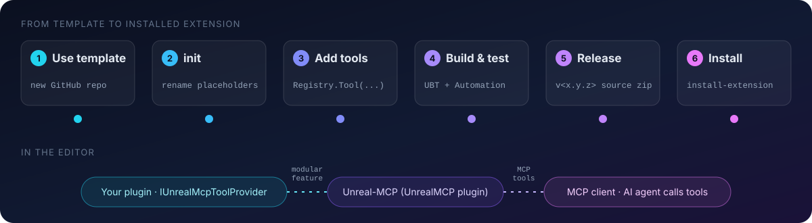

<div align="center">



<br/>

[](https://github.com/IvanMurzak/Unreal-AI-Template/generate)
[](https://github.com/IvanMurzak/Unreal-MCP)

[](LICENSE)

</div>

**Unreal AI Template** is a GitHub template repository for third-party extensions of
[AI Game Developer (Unreal-MCP)](https://github.com/IvanMurzak/Unreal-MCP). It gives you a buildable
C++ `Type=Editor` plugin that implements `IUnrealMcpToolProvider` with one sample tool, an Automation
spec, an end-to-end tool check, setup and version scripts, and CI that publishes a source-zip release.

> [!IMPORTANT]
> **Which extension shape do you need?** Unreal-MCP now exposes editor data to agents through
> **RQL** (`rql-query` / `rql-mutate` / `rql-schema`). For a new *editor feature* (Niagara, PCG, …) the
> recommended shape is an **RQL module** (`IUnrealMcpRqlModule`): start from
> [`samples/UnrealAITemplate`](https://github.com/IvanMurzak/Unreal-MCP/tree/main/samples/UnrealAITemplate)
> in Unreal-MCP and its [extension guide](https://github.com/IvanMurzak/Unreal-MCP/blob/main/docs/EXTENSIONS.md).
> This repository scaffolds the **custom tool** shape (`IUnrealMcpToolProvider`), which stays supported
> for work that is not editor data. The first-party extensions live inside Unreal-MCP
> ([`extensions/`](https://github.com/IvanMurzak/Unreal-MCP/tree/main/extensions)) and are not built from
> this template.

<p align="center">
  
</p>

## What you get

| Path | What it is |
| --- | --- |
| `YOUR_EXTENSION_MODULE/` | The UE plugin (renamed by `init`): `.uplugin` depends on `UnrealMCP`; `Private/<Module>Module.cpp` holds the provider, one sample tool and the module that registers it |
| `…/Private/Tests/` | UE Automation spec, one `It(...)` per tool |
| `Tests/e2e/` | `Run-ToolChecks.ps1` and one `tools/<tool>.e2e.ps1` check per tool (calls `unreal-mcp-cli run-tool`) |
| `commands/` | `init` (PowerShell and Python), `bump-version`, `get-version`, `update-core` |
| `extension.json` | Catalog manifest: `extensionId`, `pluginName`, `repo`, `version`, `minCoreVersion`, `enginePlugins`, `tools` |
| `.github/workflows/` | Build and test, version-gated release, version bump; `*.yml-sample` files go live on `init` |

## Quick start

**1. Create your repository.** Click **Use this template** on GitHub and name it `Unreal-AI-<Feature>`.

**2. Initialize.** UE module names cannot contain `-`, so the plugin and module use the PascalCase form.

```powershell
./commands/init.ps1 -ExtensionModule "UnrealAINiagara" -ExtensionId "com.company.unreal-ai-niagara" `
  -DisplayName "Unreal AI Niagara" -GitHubRepository "YourName/Unreal-AI-Niagara" -FeaturePlugin "Niagara"
```

```bash
python commands/init.py --module UnrealAINiagara --id com.company.unreal-ai-niagara \
  --name "Unreal AI Niagara" --repo YourName/Unreal-AI-Niagara --feature Niagara
```

`init` replaces the `YOUR_*` placeholders in file contents and names, adds the optional gating engine
plugin (`-FeaturePlugin` / `--feature`) to the `.uplugin`, uncomments its module dependencies in
`*.Build.cs`, and renames `*.yml-sample` workflows to `*.yml`. The sample tool id defaults to
`hello-extension` (`-ToolId` / `--tool`).

**3. Build against a UE project** that also has the `UnrealMCP` plugin in `Plugins/`:

```powershell
cmd /c mklink /J "<UEProject>\Plugins\UnrealAINiagara" "<thisRepo>\UnrealAINiagara"
& "C:\Program Files\Epic Games\UE_5.7\Engine\Build\BatchFiles\Build.bat" `
  <UEProject>Editor Win64 Development -project="<UEProject>\<UEProject>.uproject" -WaitMutex
```

Run the specs with `UnrealEditor-Cmd.exe "<UEProject>.uproject" -nullrhi -unattended -ExecCmds="Automation RunTests UnrealAINiagara; Quit"`.

**4. Open the editor** with both plugins enabled. The module registers its provider as a modular
feature, so Unreal-MCP adds the tools to its list; disabling the extension removes them again.

## Add a tool

Edit `RegisterTools()` in `Source/<Module>/Private/<Module>Module.cpp`. Tool ids are kebab-case
(`^[a-z0-9]+(-[a-z0-9]+)*$`, other ids are dropped). Handlers run on the game thread, so they can call
editor and engine APIs directly.

```cpp
Registry.Tool(TEXT("niagara-system-create"))
    .Title(TEXT("Create Niagara System"))
    .Description(TEXT("Creates a new Niagara system asset at the given path."))
    .ParamString(TEXT("path"), TEXT("Content path, e.g. /Game/VFX/MySystem"))
    .Handle([](const FUnrealMcpToolCall& Call) -> FUnrealMcpToolResult
    {
        const FString Path = Call.GetString(TEXT("path"));
        // ... NiagaraEditor APIs ...
        return FUnrealMcpToolResult::Success(FString::Printf(TEXT("Created %s"), *Path));
    });
```

For every tool add an `It(...)` block to the Automation spec and a `Tests/e2e/tools/<tool>.e2e.ps1` check,
and list the tool in `extension.json`. Prompts, resources and the full builder API are in the
[Unreal-MCP extension guide](https://github.com/IvanMurzak/Unreal-MCP/blob/main/docs/EXTENSIONS.md).

## Release and install

The `.uplugin` `VersionName` is the single version source. Bump it with the script (or the
`bump_version` workflow), then merge to `main`:

```powershell
./commands/bump-version.ps1 -NewVersion "0.2.0"   # .uplugin + GetExtensionVersion() + extension.json
./commands/update-core.ps1                        # set minCoreVersion to the latest Unreal-MCP release
```

`release.yml` publishes only when the version has no `v<version>` tag yet: it runs the tests, packages
the plugin source as `<Module>-<version>.zip` and creates the GitHub Release and tag in one step.
Users compile the source on their next editor open.

Install into a UE project with the Unreal-MCP CLI:

```bash
unreal-mcp-cli install-extension <extensionId> <UEProject> --source <path-to-plugin-dir>   # add --build to compile now (Windows)
```

Install by id alone (without `--source`) works only for extensions listed in the Unreal-MCP extension
index, which today contains the first-party extensions. See
[installing an extension](https://github.com/IvanMurzak/Unreal-MCP/blob/main/docs/EXTENSIONS.md#installing-an-extension-into-a-project).

## CI

The UE jobs need a self-hosted Windows runner labelled `unreal-<ue>` (for example `unreal-5-7`) and stay
skipped until you set the repository variables `UNREAL_RUNNER_READY`, `UNREAL_E2E_READY` and
`UNREAL_HOST_PROJECT`. Fork pull requests never run on that runner. Details: [docs/agents/ci.md](docs/agents/ci.md).

## Docs

- [docs/agents/architecture.md](docs/agents/architecture.md): extension shape, contract, `init` flow
- [docs/agents/ci.md](docs/agents/ci.md): workflows, repository variables, runner and host isolation
- [docs/agents/release.md](docs/agents/release.md): version gate and the atomic source-zip release
- [Unreal-MCP](https://github.com/IvanMurzak/Unreal-MCP): the core plugin, the extension guide and the
  first-party extensions

## License

[Apache-2.0](LICENSE)
